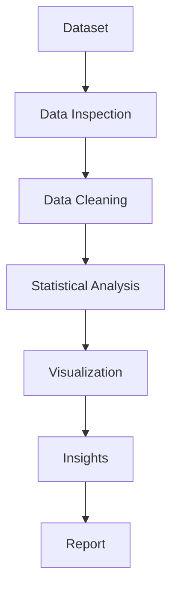

# Exploratory Data Analysis Using Python

**Author:** Muthu Anandh S.

## Overview

This project performs Exploratory Data Analysis (EDA) on a
synthetic Student Performance and Academic Factors dataset.

It uses Python, Pandas, NumPy, Matplotlib, and Seaborn to
inspect data, clean missing values, identify duplicates,
calculate statistics, visualize relationships, and generate
an analytical report.

> The dataset is simulated for educational purposes. It does
> not contain real student records.

## Objectives

- Understand the structure and quality of a dataset.
- Handle missing values and duplicate records.
- Calculate descriptive statistics.
- Analyze correlations between academic variables.
- Create meaningful charts and a dashboard.
- Generate an automatic Markdown report.

## Technologies

- Python 3
- Pandas
- NumPy
- Matplotlib
- Seaborn
- Git and GitHub

## Dataset

The dataset contains these columns:

- Student_ID
- Age
- Gender
- Department
- Study_Hours
- Attendance
- Assignment_Score
- Previous_Marks
- Final_Marks

The generator creates 1,200 simulated student records and
adds missing values and duplicate rows for practice.

## Project Workflow



## Features

- Data inspection and quality checks
- Missing-value handling
- Duplicate removal
- Numerical range validation
- IQR-based outlier detection
- Department-wise performance analysis
- Pearson correlation analysis
- Ten visualizations
- Combined EDA dashboard
- Automatic Markdown report

## Installation

Install Python 3 and open a terminal in the project folder.

```bash
pip install -r requirements.txt
```

## Run the project

First, generate the dataset:

```bash
python generate_dataset.py
```

Then run the analysis:

```bash
python main.py
```

## Output Files

- `student_performance.csv`
- `cleaned_student_performance.csv`
- `analysis_summary.csv`
- `analysis_report.md`

All charts are saved in the `visualizations/` directory.

## Visualization Gallery

### Dashboard


### Final Marks Distribution


### Department Performance


### Correlation Heatmap


### Study Hours vs Marks


### Attendance vs Marks


## Data Cleaning

1. Remove exact duplicate rows.
2. Replace invalid numerical values with missing values.
3. Fill numerical missing values using the median.
4. Fill categorical missing values using the mode.
5. Detect outliers using the IQR method without
   automatically deleting valid extreme observations.

The original dataset is preserved.

## Statistical Techniques

- Mean and median
- Standard deviation and variance
- Minimum and maximum
- Group-wise averages and counts
- Pearson correlation
- Interquartile Range (IQR)

Correlation does not prove causation.

## Limitations

The dataset is synthetic. Its findings should not be
generalized to real students or educational institutions.
Department comparisons are descriptive, not significance tests.

## Future Enhancements

- Interactive dashboard using Streamlit
- Automated unit tests
- Hypothesis testing
- Analysis of a properly licensed real dataset

## Resume Description

Developed a Python-based EDA application to clean and analyze
a synthetic student performance dataset, calculate descriptive
statistics and correlations, generate visualizations, and
produce an automatic analytical report.

## Author

Muthu Anandh S.
